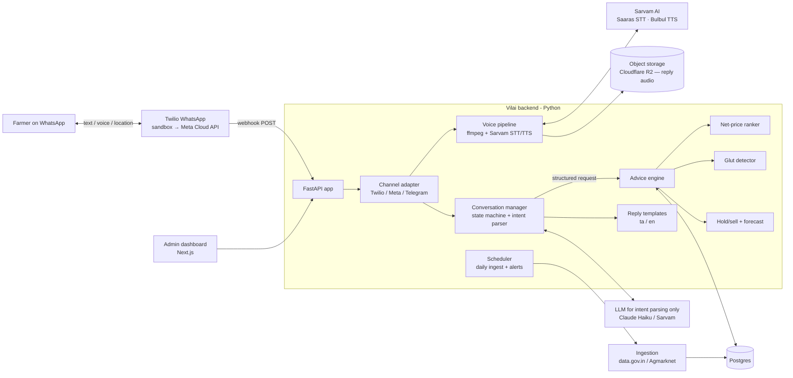

# Vilai — WhatsApp Market Advisor for Farmers

> Working name: **Vilai** (விலை, "price" in Tamil). Rename freely.
> Status: plan v1 · 2026-11-19 · Owner: Aswin R

---

## 1. What we're building and why

Indian farmers routinely sell at a loss because they don't know which mandi pays best *after transport*, or whether prices are about to crash from a supply glut. Mandi prices for onion fell to ₹5–7/kg in May 2026 while retail stayed above ₹25/kg; tomato growers in Nashik and Tamil Nadu abandoned harvests in late 2026 because everyone shipped to the same markets at the same time.

**Vilai** is a WhatsApp bot. A farmer sends a voice note or text in Tamil (or English), e.g. *"20 quintal chinna vengayam, Dindigul pakkam"*, and gets back — by text **and** voice:

1. **Where to sell:** the top 3 mandis within reach, ranked by **what the farmer takes home** (price − market deductions − transport), not headline price.
2. **When to sell** (storable crops only): hold or sell now, based on price trend, seasonal history and arrivals — shown as a range with honest confidence.
3. **Glut warnings:** "Arrivals at Oddanchatram are 60% above normal this week; prices are likely to soften."

### Who it's for
- **Primary:** small/marginal farmers in Tamil Nadu growing tomato, small onion, turmeric, banana.
- **Secondary (later):** FPOs pooling produce, who need the same answers at larger volumes.

### Goals
- Advice that is *correct, explainable and dated* ("prices as of 18 Nov").
- Works for a farmer who can't read well (voice in, voice out).
- Zero install: WhatsApp only.

### Non-goals (v1)
- Selling, payments, buyer matching, logistics booking.
- Crops/states outside the pilot set.
- A farmer-facing app or website.

### Anti-goals (failure even if it "works")
- **The bot states a price that isn't in the data.** Every number must come from the engine, never from an LLM.
- Advice presented as certain. Forecasts are ranges; data age is always shown.
- Collecting more personal data than needed.

### Success metrics (pilot)
| Metric | Target |
|---|---|
| Queries answered without human help | ≥ 85% |
| Intent parsed correctly (crop, qty, location) | ≥ 90% on golden test set |
| Median reply latency | < 8 s text, < 20 s voice |
| Avg "extra take-home vs nearest mandi" shown | tracked per query |
| Farmers who report acting on advice | tracked via 1-tap follow-up |
| Forecast backtest error | shown to users only if MAPE below threshold (§6.4) |

---

## 2. User experience

### 2.1 First contact (onboarding, ~4 messages)
1. Greeting + language choice: *1 தமிழ் / 2 English*.
2. Consent: what we store (phone, location, crops) and why; reply **YES** to continue. Required before storing anything.
3. Location: "Share your location 📍 or send your pincode."
4. Crops: "Which crops do you grow?" (free text or voice; parsed and confirmed).

### 2.2 Asking for advice
```
Farmer (voice, Tamil): "இருபது குவிண்டால் சின்ன வெங்காயம் இருக்கு, எங்க விக்கலாம்?"
Bot:   Confirm: Small onion, 20 quintals, from Dindigul area. Correct? (1 Yes / 2 Change)
Farmer: 1
Bot (text + voice note):
  Small onion · 20 q · prices as of 18 Nov
  1. Oddanchatram — ₹2,450/q · 42 km → you keep ≈ ₹2,330/q (≈ ₹46,600)
  2. Dindigul — ₹2,300/q · 8 km → ≈ ₹2,250/q (≈ ₹45,000)
  3. Palani — ₹2,380/q · 58 km → ≈ ₹2,220/q (≈ ₹44,400)
  ⚠ Oddanchatram arrivals are 35% above normal this week — prices may soften.
  Hold or sell? In 4 of the last 5 years prices rose 8–18% over the next month;
  expect ~X% storage loss. Reply ALERT for a daily price update.
```
*(Numbers are illustrative.)*

### 2.3 Other intents
- `price <crop> <mandi>` — today's price at one mandi.
- `alert` / `stop` — subscribe/unsubscribe daily price updates.
- `change crops`, `change location`, `language`.
- `help`, plus unknown → short help menu.

Every reply ends with the data date and a one-line disclaimer on first use per day.

---

## 3. Architecture



### 3.1 Components

| Component | Responsibility | Notes |
|---|---|---|
| **Channel adapter** | Normalise inbound messages (text, audio, location) into one `InboundMessage`; send replies. | Interface so Meta Cloud API / Telegram / web can be added later without touching the core. |
| **Voice pipeline** | Download audio → convert OGG/Opus to WAV (ffmpeg) → Sarvam **Saaras v3** STT. Reply text → Sarvam **Bulbul** TTS → upload to R2 → public URL for Twilio. | WhatsApp can't carry text and audio in one message, so send text first, then audio. |
| **Conversation manager** | Per-farmer state machine (onboarding, awaiting confirmation, idle). Calls intent parser, validates, asks for missing slots, always confirms crop + qty + location before advising. | State in Postgres; no in-memory sessions. |
| **Intent parser** | LLM turns free text (Tamil/English/code-mixed) into strict JSON: `{intent, commodity, quantity, unit, location_text, market}`. | Output validated with Pydantic; commodity resolved against our dictionary. **The LLM never writes reply text with numbers.** Rule-based fallback for simple commands. |
| **Advice engine** | Pure Python, deterministic, unit-tested. Inputs: commodity, qty, farmer location, date. Outputs: ranked mandis, glut flags, hold/sell signal, data freshness. | Core value; no I/O except DB reads. |
| **Reply templates** | Language-specific templates (YAML/Jinja) filled with engine output. | Tamil templates reviewed by a native speaker. |
| **Ingestion** | Daily fetch of prices + arrivals; normalise names/units; upsert. Historical backfill script. | Source adapters behind one interface (§4). |
| **Scheduler** | Daily ingest (evening, after mandis report), alert fan-out, data-freshness check. | APScheduler in-process for pilot; move to a cron/worker later. |
| **Admin dashboard** | Data freshness, users, query log, recommendations audit, parse failures. | Phase 5. Behind auth. |

### 3.2 Request flow (voice query)
1. Twilio POSTs webhook → verify `X-Twilio-Signature` → return 200 fast.
2. Background task: fetch media → STT → text.
3. Conversation manager loads state → intent parser → slot filling / confirmation.
4. On confirmation: engine computes advice → stored in `recommendations` (audit).
5. Template renders text → send text message → TTS → upload → send audio message.

Respond to the webhook immediately and process asynchronously (FastAPI `BackgroundTasks` for pilot; a queue such as RQ/Redis later), since STT+TTS can exceed Twilio's webhook timeout.

---

## 4. Data

### 4.1 Sources
| Source | Use | Status / risk |
|---|---|---|
| **data.gov.in OGD API** — "Current Daily Price of Various Commodities from Various Markets (Mandi)" (from Agmarknet) | Daily prices (min/max/modal) | Needs free API key. ⚠ The resource page currently says an API doesn't exist for it; **verify in Phase 0**. The "Variety-wise Daily Market Prices" dataset is the likely alternative. |
| **Agmarknet portal / Agmarknet 2.0 dashboard** | Prices **and arrivals**, history | Arrivals are essential for glut detection. May need CSV export or careful, polite scraping. |
| **CEDA Ashoka Agmarknet portal** | Multi-year historical prices + arrivals for backfill | Good for building seasonal history. |
| **Mandi master list** (we build it) | Name, district, lat/lon, deductions | Hand-curated CSV for the ~15–25 pilot mandis; geocode once. |
| **Pincode → lat/lon** | Farmer location when no GPS pin | India Post pincode dataset (open). |

All sources go behind `PriceSource` adapters returning a common `PriceObservation`, so swapping or combining sources is cheap.

### 4.2 Pilot scope
- **Commodities:** tomato, small onion, turmeric, banana (map each to its exact Agmarknet commodity + variety names in Phase 0).
- **Mandis (candidates — confirm they report regularly):** Oddanchatram, Dindigul, Palani, Coimbatore, Mettupalayam, Pollachi, Erode, Perambalur, Salem, Madurai, Tiruppur, Udumalpet, Krishnagiri, Hosur.
- **History:** 5 years where available.

### 4.3 Data model (Postgres)
```
markets(id, name, district, state, lat, lon, agmarknet_name, deductions_pct, active)
commodities(id, agmarknet_name, variety, name_en, name_ta, synonyms text[],
            storable bool, storage_loss_pct_per_week numeric, unit)
price_observations(id, obs_date, market_id, commodity_id, variety, grade,
                   min_price, max_price, modal_price,          -- ₹ per quintal
                   arrivals_tonnes, source, ingested_at,
                   UNIQUE(obs_date, market_id, commodity_id, variety))
farmers(id, phone_e164, language, lat, lon, pincode, consent_at, created_at)
farmer_crops(farmer_id, commodity_id)
conversation_state(farmer_id PK, state, slots jsonb, updated_at)
messages(id, farmer_id, direction, kind, body, media_url, parsed jsonb, created_at)
recommendations(id, farmer_id, request jsonb, result jsonb, data_as_of date, created_at)
alert_subscriptions(id, farmer_id, commodity_id, market_id null, active)
settings(key, value jsonb)   -- transport rates, thresholds
```

### 4.4 Data-quality rules
- Normalise everything to **₹/quintal** and **tonnes**; reject rows where min > modal > max ordering is violated or prices sit far outside the commodity's historical range (flag, don't silently drop).
- Track `last_reported_date` per market × commodity; treat > 3 days as **stale** (shown, but marked and ranked lower).
- Synonym dictionary for crop names: English, Tamil script, transliterated Tamil (e.g. தக்காளி / thakkali → tomato; சின்ன வெங்காயம் / chinna vengayam → small onion; மஞ்சள் / manjal → turmeric; வாழை / vaazhai → banana).

---

## 5. Tech stack

| Layer | Choice | Why |
|---|---|---|
| Language | Python 3.12 | Data + ML + web in one language |
| API | FastAPI + Pydantic v2 | Async webhooks, typed models |
| DB | PostgreSQL 16 (Neon/Supabase free tier) + SQLAlchemy 2 + Alembic | Relational, time-series fits fine at this scale |
| Data/ML | pandas, statsmodels, LightGBM (later) | Simple first, stronger models only if backtests justify it |
| Messaging | Twilio WhatsApp (sandbox → production sender); Meta Cloud API adapter later | Fast start without business verification |
| Voice | Sarvam AI: Saaras v3 (STT), Bulbul (TTS, Tamil voices); ffmpeg | Built for Indian languages, handles code-mixing |
| Intent LLM | Claude Haiku (`claude-haiku-5-5`) via tool-use/JSON; Sarvam-105B as alternative | Pluggable `IntentParser` interface |
| Storage | Cloudflare R2 (S3-compatible) for TTS audio | Twilio needs a public media URL |
| Scheduler | APScheduler (pilot) | Simple; replace with worker/cron at scale |
| Dashboard | Next.js + Tailwind (Phase 5) | Your full-stack strength |
| Deploy | Docker → Railway / Render / Fly.io | One container + managed Postgres |
| Quality | pytest, ruff, mypy, GitHub Actions CI | |

---

## 6. Advice engine (the core logic)

All functions are pure and unit-tested with fixture data.

### 6.1 Net take-home per mandi
```
gross        = modal_price(m, latest_date)                       # ₹/q
deductions   = gross × deductions_pct(m)                          # market fee, commission (configurable per mandi)
distance_km  = road_distance(farmer, m)                           # v1: haversine × 1.3 road factor; v2: OSRM
transport    = trip_cost(distance_km, qty) / qty                  # ₹/q
net          = gross − deductions − transport
total        = net × qty
```
- `trip_cost`: choose vehicle by quantity (e.g. tempo / small truck / truck) from a configurable rate table (₹/km, round trip). Farmer can override with their own rate ("my tempo costs ₹X").
- Uncertainty: also compute `net` using min and max price → show "≈" and use the range internally to avoid over-precise claims.
- Candidate mandis: within a max radius (default 100 km), reported within 3 days. Rank by `net`; tie-break by freshness.
- Output also: `extra_vs_nearest = total(best) − total(nearest)`.

### 6.2 Glut detector
```
baseline = median(arrivals, same market × commodity, previous 28 days, excluding today)
z        = (arrivals_today − baseline) / MAD
flag if arrivals_today ≥ 1.3 × baseline and z ≥ 2   (thresholds in settings)
```
Also flag a *regional* glut when ≥ half of nearby mandis spike together. Backtest: does a flag precede a modal-price drop over the next 3–7 days? Tune thresholds on history before showing it to farmers.

### 6.3 Hold or sell (storable crops only: small onion, turmeric)
1. **Seasonal view:** for the same calendar week in each past year, compute price change over the next 4 weeks → "rose in 4 of 5 years, by 8–18%".
2. **Current trend:** 14-day slope of modal price + arrivals trend.
3. **Costs of holding:** storage loss % per week (onion shrinkage) + optional holding cost.
4. **Signal:** `HOLD` only if the expected gain range clears storage loss with margin in most past years; otherwise `SELL`; `UNCLEAR` when history disagrees. Always show the reasoning in one line.

Perishables (tomato, banana) never get a hold/sell signal — only where-to-sell and glut warnings.

### 6.4 Forecasts (Phase 4, gated)
- Baselines first: seasonal-naive and 7-day moving average.
- Then a LightGBM model on lags, arrivals, seasonality, nearby-mandi prices.
- **Rolling-origin backtest** per commodity × horizon (7 and 14 days). Only expose forecasts where the model beats the baseline **and** MAPE is under a threshold (start 15%). Present as a range (p10–p90), never a point.

### 6.5 Guardrails
- If data is stale or missing for the farmer's area: say so plainly and show the nearest fresh data instead of guessing.
- Never recommend a mandi that hasn't reported this commodity in the last 3 days as #1.
- Log every recommendation with `data_as_of` for audit.

---

## 7. Conversation & language

- **State machine** (explicit, testable): `NEW → LANG → CONSENT → LOCATION → CROPS → IDLE ⇄ CONFIRM_QUERY → ADVISED`.
- **Intent parsing:** LLM with a strict JSON schema; validate; resolve commodity via synonym dictionary; if anything is missing or low-confidence, ask one short question. **Always confirm** crop, quantity and location before giving advice (protects against STT mistakes).
- **Units:** accept quintal, kg, tonne, bags (ask bag weight if needed), crates for tomato (configurable kg per crate).
- **Replies:** templates only. Keep text messages short (≤ 8 lines). TTS reads a shorter spoken version (top choice + warning).
- **Languages:** Tamil and English in v1; template structure ready for Hindi/Telugu/Kannada.
- **WhatsApp rules to design around:**
  - Free-form replies only within 24 hours of the farmer's last message. **Proactive alerts outside that window need pre-approved template messages** (production sender). In the sandbox, only numbers that joined can be messaged.
  - Text and audio go in separate messages.

---

## 8. Repository structure

```
vilai/
├── CLAUDE.md
├── README.md
├── docker-compose.yml          # app + postgres for local dev
├── Dockerfile
├── pyproject.toml
├── .env.example
├── alembic/                    # migrations
├── app/
│   ├── main.py                 # FastAPI app, routers, startup
│   ├── config.py               # pydantic-settings
│   ├── db.py
│   ├── models/                 # SQLAlchemy tables
│   ├── schemas/                # Pydantic DTOs (InboundMessage, AdviceRequest, AdviceResult…)
│   ├── api/
│   │   ├── webhooks_twilio.py
│   │   ├── advice.py           # POST /v1/advice (used by bot, tests, dashboard)
│   │   └── admin.py
│   ├── channels/               # base.py, twilio_whatsapp.py, (meta_cloud.py, telegram.py later)
│   ├── conversation/           # state_machine.py, intent_parser.py, slots.py, templates/{ta,en}.yaml
│   ├── voice/                  # audio.py (ffmpeg), stt_sarvam.py, tts_sarvam.py, storage_r2.py
│   ├── engine/                 # net_price.py, ranking.py, glut.py, hold_sell.py, forecast/
│   ├── data/
│   │   ├── sources/            # base.py, datagov.py, agmarknet_csv.py, ceda.py
│   │   ├── ingest.py, normalize.py, backfill.py
│   │   └── seed/               # markets.csv, commodities.yaml, transport_rates.yaml
│   └── jobs/                   # scheduler.py, daily_ingest.py, alerts.py, freshness.py
├── notebooks/                  # data exploration, backtests
├── tests/
│   ├── fixtures/               # sample price/arrival CSVs, sample Twilio payloads
│   ├── engine/  conversation/  data/  api/
│   └── golden/intents.yaml     # utterance → expected parse (Tamil, English, code-mixed)
├── dashboard/                  # Next.js admin (Phase 5)
└── docs/PROJECT_PLAN.md
```

### Internal API
| Method | Path | Purpose |
|---|---|---|
| POST | `/webhooks/twilio/whatsapp` | Inbound messages (signature-verified) |
| POST | `/v1/advice` | `{commodity, quantity, unit, lat, lon}` → ranked mandis, glut flags, hold/sell, `data_as_of` |
| GET | `/v1/prices?commodity=&market=&days=` | Price history |
| GET | `/v1/markets`, `/v1/commodities` | Reference data |
| GET | `/admin/freshness`, `/admin/queries`, `/admin/recommendations` | Dashboard (auth) |
| GET | `/healthz` | Health check |

### Environment variables (`.env.example`)
```
DATABASE_URL=
DATAGOV_API_KEY=
TWILIO_ACCOUNT_SID=
TWILIO_AUTH_TOKEN=
TWILIO_WHATSAPP_FROM=whatsapp:+14155238886
PUBLIC_BASE_URL=            # for webhook signature validation
SARVAM_API_KEY=
ANTHROPIC_API_KEY=          # or SARVAM for intent parsing
INTENT_PROVIDER=anthropic   # anthropic | sarvam | rules
R2_ACCOUNT_ID=
R2_ACCESS_KEY_ID=
R2_SECRET_ACCESS_KEY=
R2_BUCKET=
R2_PUBLIC_BASE_URL=
ADMIN_TOKEN=
```

---

## 9. Delivery plan

Rough sizing for one developer working with Claude Code. Each phase ends with a demo and its exit criteria met.

### Phase 0 — Data spike (2–3 days) ⚠ do this first
- [ ] Get a data.gov.in API key; confirm which resource returns daily TN mandi prices; record exact field names.
- [ ] Find a reliable source for **arrivals** + 5-year history (Agmarknet export / CEDA); download for the 4 crops × candidate mandis.
- [ ] Map Agmarknet commodity/variety names; check units (banana especially).
- [ ] Build `markets.csv` with lat/lon; drop mandis that rarely report.
- [ ] Notebook: coverage heatmap (mandi × crop × days reported), price & arrivals plots, obvious outliers.
- **Exit:** a clean historical CSV + a script that fetches yesterday's data. Go/no-go on crops and mandis.

### Phase 1 — Core + engine (4–5 days)
- [ ] Repo scaffold, Docker Compose, Postgres, Alembic, CI (ruff, mypy, pytest).
- [ ] Ingestion adapters, normaliser, upsert, backfill, data-quality checks.
- [ ] Engine: net-price ranking, glut detector (with backtest notebook), freshness rules.
- [ ] `POST /v1/advice` + tests with fixtures.
- **Exit:** `curl /v1/advice` returns sensible ranked mandis for all 4 crops; engine test coverage ≥ 90%.

### Phase 2 — WhatsApp text bot (3–4 days)
- [ ] Twilio sandbox + ngrok; webhook with signature validation; async processing.
- [ ] State machine: onboarding (language, consent, location pin/pincode, crops).
- [ ] Intent parser (LLM + rules fallback) + golden test set (≥ 60 utterances: Tamil script, transliterated, English, code-mixed).
- [ ] Tamil + English templates; confirm-before-advise flow; help/unknown handling.
- **Exit:** 5 friends complete onboarding and get correct advice by text; golden set ≥ 90%.

### Phase 3 — Voice (3 days)
- [ ] Voice notes in: download → ffmpeg → Saaras STT → same pipeline.
- [ ] Voice out: short spoken summary → Bulbul TTS (Tamil voice) → R2 → audio message.
- [ ] Latency logging per step.
- **Exit:** voice round trip < 20 s median; crop names recognised in ≥ 85% of test recordings (record 20+ real samples with different speakers).

### Phase 4 — Hold/sell, alerts, forecasts (5–7 days)
- [ ] Seasonal hold/sell analysis for small onion and turmeric, with backtest.
- [ ] `ALERT` subscriptions + daily alert job (within session rules; plan templates for production).
- [ ] Forecast baselines → LightGBM; rolling backtests; gating logic.
- **Exit:** hold/sell shown only where backtests support it; alerts delivered reliably for a week.

### Phase 5 — Dashboard, deploy, pilot (5 days)
- [ ] Next.js admin: freshness, users, queries, parse failures, recommendation audit.
- [ ] Deploy (Docker → Railway/Render/Fly), managed Postgres, R2, monitoring (Sentry), daily DB backup.
- [ ] Privacy: consent text, `DELETE MY DATA` command, data retention policy (DPDP Act 2023).
- [ ] Pilot with 5–10 farmers or an FPO; 1-tap feedback after each advice ("Did you sell? Where?").
- **Exit:** 2 weeks of pilot use, feedback summarised, top 5 fixes listed.

### Phase 6 — Later
- Move to a production WhatsApp sender (Meta Cloud API or Twilio approved number) with alert templates.
- FPO mode: pooled lots, group alerts, buyer-facing price sheet.
- More crops, districts, Hindi/Telugu/Kannada.
- OSRM road distances; spread recommendations when many farmers query the same day (avoid creating gluts).
- AgriStack UFSI integration if/when sandbox access is available.

---

## 10. Testing strategy

| Layer | How |
|---|---|
| Engine | Unit tests with small fixture CSVs; property tests (net ≤ gross, ranking stable, stale data never #1). |
| Glut / hold-sell / forecast | Notebook + scripted backtests on history; metrics stored in `docs/backtests.md`. |
| Ingestion | Fixture API responses; schema-drift test that fails loudly if source fields change. |
| Intent parsing | Golden YAML set; run in CI with `rules` provider and nightly with the LLM provider. |
| Conversation | State-machine tests driven by scripted message sequences. |
| Webhook | Signature validation tests with recorded Twilio payloads (text, audio, location). |
| End-to-end | Manual script on real WhatsApp before each demo. |

---

## 11. Risks and mitigations

| Risk | Mitigation |
|---|---|
| Data API unavailable or changes | Phase 0 first; adapter layer; multiple sources; schema-drift alerts. |
| Mandis report late or not at all | Freshness flags; rank stale data lower; show data date always. |
| Bad advice causes a loss | Ranges not points; show reasoning; gated forecasts; disclaimer; audit log. |
| STT mishears crop/quantity/place | Mandatory confirmation step; synonym dictionary; collect real voice samples. |
| LLM invents numbers | LLM only parses; replies are templates filled by the engine. |
| WhatsApp policy (24 h window, templates, sandbox limits) | Design alerts around it; plan template approval before pilot alerts. |
| Transport cost assumptions wrong | Configurable rates; farmer can set own rate; show distance so they can judge. |
| Everyone sent to the same mandi | Not an issue at pilot scale; later, spread recommendations by load. |
| Privacy (phone + location) | Explicit consent, minimal fields, encryption at rest, delete-on-request. |
| API costs (Twilio, Sarvam, LLM) | Free tiers/credits for pilot; cache parses; TTS only short summaries; monitor spend. |

---

## 12. Open questions (decide during build)
1. Do we have access to real farmers/an FPO for the pilot? (Changes crops/mandis and Phase 5.)
2. Market deductions per mandi — need local confirmation (commission agents vary).
3. Typical local transport rates by vehicle — gather from 3–4 farmers/transporters.
4. Bag/crate weights per crop in the pilot area.
5. Which LLM parses Tamil code-mixed text best — compare Claude Haiku vs Sarvam on the golden set in Phase 2.
